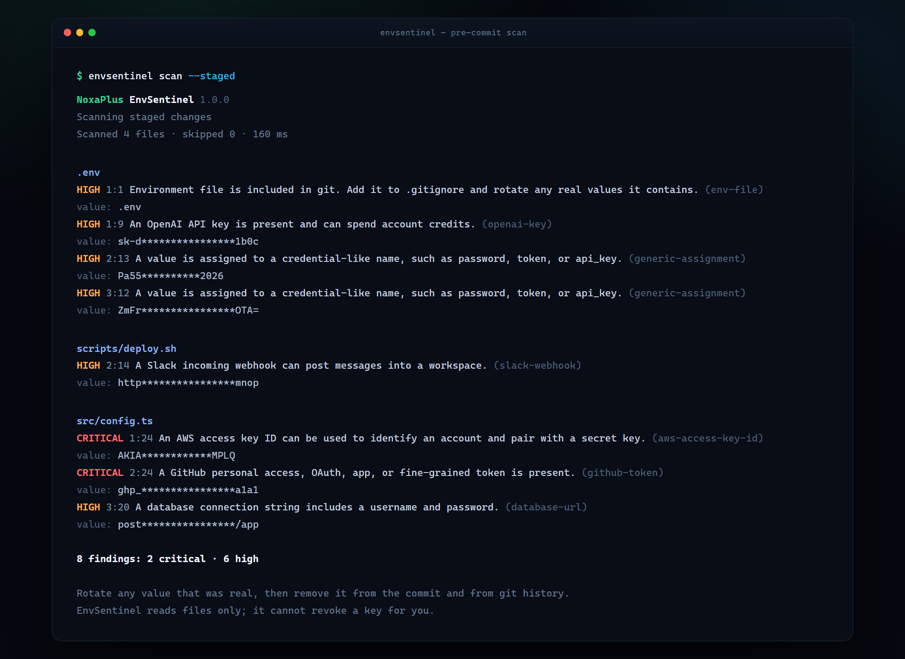

# NoxaPlus EnvSentinel

**The secret you are about to commit is the one that gets you paged on a Saturday.**

EnvSentinel reads your files, compares them against the shapes real credentials have, and tells you what should not be in a commit — before `git push` makes it everyone's problem. It runs locally, needs no account, and finishes in milliseconds. When it finds something, it shows enough to locate the value and not enough to leak it again.

[](https://github.com/noxaplus-star/noxaplus-envsentinel/actions/workflows/ci.yml)
[](LICENSE)
[](https://nodejs.org/)

[GitHub repository](https://github.com/noxaplus-star/noxaplus-envsentinel) · [NoxaPlus](https://www.noxaplus.ir)



## Why this exists

Secret scanning usually shows up after the damage: a bot comments on the pull request, the key is already public, and the next hour is spent rotating credentials and reading logs. The useful moment is earlier — on the developer's machine, on the exact bytes that are about to enter the index.

EnvSentinel is built for that moment. It scans staged content, not the working tree, so what it checks is what the commit will contain. It knows the difference between a placeholder and a live key, it masks what it prints, and it can install itself as a pre-commit hook so nobody has to remember to run it.

## Quick start

Requires Node.js 22 or newer. There are no runtime dependencies.

```bash
git clone https://github.com/noxaplus-star/noxaplus-envsentinel.git
cd noxaplus-envsentinel
npm ci
npm run build
node dist/cli.js scan
```

Install the release package globally if you want the `envsentinel` command anywhere:

```bash
npm install -g https://github.com/noxaplus-star/noxaplus-envsentinel/releases/download/v1.0.0/noxaplus-envsentinel-1.0.0.tgz
envsentinel scan
```

A scan that finds nothing exits quietly. A scan that finds something looks like this:

```text
NoxaPlus EnvSentinel 1.0.0
Scanning staged changes
Scanned 4 files · skipped 0 · 160 ms

src/config.ts
  CRITICAL 1:24      An AWS access key ID can be used to identify an account and pair with a secret key.  (aws-access-key-id)
                     value: AKIA************MPLQ
  CRITICAL 2:24      A GitHub personal access, OAuth, app, or fine-grained token is present.  (github-token)
                     value: ghp_****************a1a1
  HIGH     3:20      A database connection string includes a username and password.  (database-url)
                     value: post****************/app

3 findings: 2 critical · 1 high

Rotate any value that was real, then remove it from the commit and from git history.
EnvSentinel reads files only; it cannot revoke a key for you.
```

## What it catches

EnvSentinel ships 27 rules across four groups.

- **Provider tokens.** AWS access key IDs and secret keys, GitHub, GitLab, npm, Slack tokens and webhooks, Stripe live and test keys, Google API keys, SendGrid, Mailgun, OpenAI, Anthropic, Hugging Face, DigitalOcean, Discord bot tokens.
- **Credential shapes.** Private key blocks, JSON Web Tokens, database URLs with a username and password, URLs with embedded credentials, and assignments to names such as `password`, `api_key`, `client_secret`, or `auth_token`.
- **Sensitive files.** `.env` and `.env.*`, private key files (`id_rsa`, `.pem`, `.p12`, `.pfx`, `.key`), credential files, and `.npmrc`.
- **Unclassifiable secrets.** Long, high-entropy quoted strings with letters and digits that match no known provider. This is what catches the internal token someone invented last quarter.

Run `envsentinel rules` for the full list with IDs and severities.

### What it deliberately does not do

- **It does not print the secret.** Every reported value is masked before it reaches the terminal, JSON, or SARIF.
- **It does not treat every `password = ...` as a crisis.** Values that look like placeholders, examples, or templates are skipped, and you can allowlist patterns per repository.
- **It does not call home.** No telemetry, no uploads, no account. The scanner is a process that reads files and exits.

## Pre-commit hook

```bash
envsentinel install-hook
```

The installer writes `.git/hooks/pre-commit` with a marker, makes it executable, and points it at your local installation. From then on, `git commit` scans the staged content and blocks the commit when a finding is at or above `high`.

```sh
#!/bin/sh
# Installed by NoxaPlus EnvSentinel
exec ./node_modules/.bin/envsentinel scan --staged --fail-on high
```

It will not overwrite a hook it did not write. If your team already has a pre-commit hook, use `--force` only after moving that logic somewhere safe, or call `envsentinel scan --staged` from inside the existing hook.

Remove the hook by deleting `.git/hooks/pre-commit`. Nothing else is touched.

## CLI reference

```text
envsentinel [scan] [paths...] [options]
envsentinel install-hook [--force]
envsentinel rules
envsentinel --help
envsentinel --version
```

| Option | Description |
| --- | --- |
| `--staged` | Scan files staged for commit (`git show :path`) instead of the working tree. |
| `--format <text\|json\|sarif>` | Report format. Default: `text`. |
| `--out <path>` | Write the report to a file instead of stdout. |
| `--fail-on <level>` | Exit non-zero at or above `low`, `medium`, `high`, or `critical`. Default: `high`. |
| `--config <path>` | Config file. Default: `.envsentinel.json` when present. |
| `--exclude <glob>` | Add an ignore pattern. Repeatable. |
| `--no-entropy` | Disable high-entropy detection. |
| `--no-color` | Disable ANSI colors in text output. |
| `--quiet` | Suppress the report-written status line. |

Exit codes are deliberate so CI can depend on them:

| Code | Meaning |
| --- | --- |
| `0` | No findings at or above `--fail-on`. |
| `1` | At least one finding at or above `--fail-on`. |
| `2` | Invalid usage, unreadable config, missing path, or a git error. |

Without a path, `envsentinel` scans the current directory. In tree mode it respects ignore rules and skips binaries, minified files, lockfiles, and anything over 1 MiB. In staged mode it scans only files git is about to commit, including staged content for files that are also modified in the working tree.

## Configuration

Create `.envsentinel.json` at the repository root. Every field is optional.

```json
{
  "ignorePaths": ["fixtures/**", "docs/samples/**"],
  "ignoreRules": ["stripe-test-key"],
  "allowPatterns": ["example\\.invalid", "REPLACE_ME_[A-Z]+"],
  "entropyThreshold": 4.5,
  "entropyMinLength": 32,
  "maxFileSizeKb": 1024
}
```

| Field | Default | Purpose |
| --- | --- | --- |
| `ignorePaths` | built-in list | Extra globs to skip. Added to the defaults. |
| `ignoreRules` | `[]` | Rule IDs to disable entirely. |
| `allowPatterns` | `[]` | Regular expressions; a finding whose value matches one is skipped. |
| `entropyThreshold` | `4.5` | Minimum Shannon entropy per character for the entropy rule. |
| `entropyMinLength` | `32` | Minimum candidate length for the entropy rule. |
| `maxFileSizeKb` | `1024` | Files larger than this are skipped. |

Unknown fields are ignored so a config written for a newer version still runs. Invalid JSON, a non-array where an array is expected, or an invalid `allowPatterns` regex exits with code `2` and names the field.

## Suppressing a finding

Sometimes a match is genuinely fine — a published test key, a documentation example, a rotated token in a fixture. Suppress it at the line, not globally:

```ts
// envsentinel:ignore-next-line
const demoKey = "sk-test-...";

const publicToken = "pk_live_publishable"; // envsentinel:ignore

const example = "user:password@host"; // envsentinel:ignore generic-assignment,url-credentials
```

`envsentinel:ignore` applies to the line it is written on. `envsentinel:ignore-next-line` applies to the following line. Rule IDs after the marker narrow the suppression; without them, every finding on that line is skipped.

## JSON and SARIF output

`--format json` produces a stable object for scripts:

```json
{
  "tool": "envsentinel",
  "name": "NoxaPlus EnvSentinel",
  "version": "1.0.0",
  "scannedAt": "2026-11-13T10:20:30.000Z",
  "mode": "staged",
  "root": ".",
  "summary": {
    "filesScanned": 4,
    "filesSkipped": 0,
    "durationMs": 160,
    "counts": { "critical": 2, "high": 1, "medium": 0, "low": 0 },
    "total": 3
  },
  "findings": [
    {
      "ruleId": "github-token",
      "ruleName": "GitHub token",
      "severity": "critical",
      "file": "src/config.ts",
      "line": 2,
      "column": 24,
      "match": "ghp_****************a1a1",
      "message": "A GitHub personal access, OAuth, app, or fine-grained token is present."
    }
  ]
}
```

`--format sarif` produces SARIF 2.1.0 for GitHub code scanning and any other SARIF consumer. It includes all 27 rules, severity-to-level mapping, `security-severity` scores, the masked value in the message, and a stable fingerprint so repeated scans update one alert instead of creating duplicates.

```bash
envsentinel scan --format sarif --out envsentinel.sarif
```

A minimal GitHub Actions job:

```yaml
- run: npm ci && npm run build
- run: node dist/cli.js scan --format sarif --out envsentinel.sarif --fail-on critical
- uses: github/codeql-action/upload-sarif@v3
  if: always()
  with:
    sarif_file: envsentinel.sarif
```

## How it works

1. **Loads a config**, merges it with the built-in ignore list, and validates every field.
2. **Collects input.** Tree mode walks the directory and skips ignored paths, binaries, lockfiles, and files past the size limit. Staged mode asks git for the index (`git diff --cached --name-only -z`) and reads each blob with `git show :path`, so uncommitted edits cannot hide a problem or create a false one.
3. **Matches line by line** with rule regexes, then runs entropy detection on quoted values that look like a single secret. Placeholders, environment references, and template expressions are filtered out.
4. **Deduplicates.** One line can match several rules; EnvSentinel keeps the most specific explanation. JWT and provider rules beat the generic assignment rule, and the generic rule beats entropy.
5. **Masks and reports.** Values are shortened to a recognizable prefix and suffix with the middle replaced. The finding carries file, line, column, rule, severity, and a sentence a human can act on.

The scanner never deletes, rewrites, or stages anything. Rotation is your job; the tool's job is to make sure you find out in time.

## Rules and severity

| Severity | Meaning | Typical examples |
| --- | --- | --- |
| `critical` | Live provider credentials that grant direct access or spend money. | AWS secret key, GitHub token, private key block. |
| `high` | Credentials with real impact, or secrets that grant a session. | Database URL, OpenAI key, Slack webhook, `.env` in git. |
| `medium` | Lower-impact or often-public values that still deserve a look. | JWT, `.npmrc`, Mailgun key. |
| `low` | Context clues and test-mode keys. | Stripe test key, high-entropy string. |

Default `--fail-on` is `high`, which keeps hooks fast and focused. Use `--fail-on medium` for stricter repositories, or `--fail-on none` when you only want a report.

## Privacy

EnvSentinel runs entirely on your machine and makes no network requests. It has no runtime dependencies, sends no telemetry, and never writes outside the report path you give it. Findings contain masked values. The original secret stays in the file where it already was.

## Limits and honest expectations

- **Pattern matching cannot prove safety.** A secret with an unusual format may pass. A clean scan means "nothing matched", not "nothing is wrong".
- **Rotate first.** If a real credential was committed, removing it from the latest commit is not enough — assume it is compromised, revoke it, and rewrite history where appropriate.
- **Entropy is a heuristic.** It produces occasional noise on hashes and encoded data. Raise `entropyThreshold`, use `allowPatterns`, or disable it with `--no-entropy`.
- **Staged mode needs a git repository.** It does not scan untracked files, which is the point: it checks what the commit will contain.
- **Binary files are skipped.** Text is the target. Archives and images are not unpacked.

## Development

```bash
npm ci
npm run typecheck
npm test        # 95 tests, no network required
npm run build
npm run scan    # scan the bundled examples directory
```

The code is organized as small modules:

- `src/rules.ts` — the 27 rules and their messages;
- `src/entropy.ts` — Shannon entropy and candidate extraction;
- `src/scanner.ts` — line scanning, placeholders, suppression, deduplication;
- `src/config.ts` — defaults, glob matching, config parsing;
- `src/git.ts` — staged files, repository checks, hook installation;
- `src/report.ts` — text and JSON renderers;
- `src/sarif.ts` — SARIF 2.1.0 builder;
- `src/cli.ts` — argument parsing, exit codes, file output;
- `src/index.ts` — the programmatic API.

Tests build their fake secrets at runtime instead of committing literal tokens, so the repository can scan itself cleanly.

## License

MIT © 2026 NoxaPlus. See [LICENSE](LICENSE). Security reports are handled according to [SECURITY.md](SECURITY.md), and changes are recorded in [CHANGELOG.md](CHANGELOG.md).
